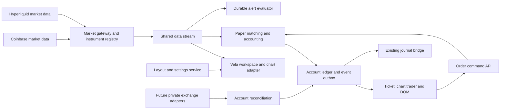

# New trading application: Vela implementation plan

Draft v1 · October 10, 2026 · Planning deliverable; application implementation has not started.

Build a separate trading application with TradingView-style charting and trading workflows, using Vela and reusable components from The Trader. The user confirmed **Supercharts and the trading workspace first, with the full platform backlog retained**. Preserve Coinbase and Hyperliquid connections. Working title: **The Trader Terminal**; branding is provisional.

The target is functional and interaction parity with a frozen TradingView reference. “Identical” is an acceptance target, not a claim about the current app, Vela, PineTS, data coverage, or this draft. Every reference feature needs a catalog entry and a passing comparison before parity can be declared. This document establishes the product scope and engineering contracts; a logged-in, plan-specific TradingView UI inventory remains the first implementation task. Features added by TradingView after that inventory require change tracking.

## Deliverables

- [Detailed requirements](BTC_ETH_SOL_MTF_Trading_Application_Requirements_2026-10-10.md): numbered requirements, implementation responsibility, phase and acceptance criteria.
- [Machine-readable backlog](BTC_ETH_SOL_MTF_Trading_Application_Backlog_2026-10-10.json): the same requirements, all initially proposed and unverified.
- [Reuse audit](BTC_ETH_SOL_MTF_Trading_Application_Reuse_Audit_2026-10-10.md): inspected source, reuse recommendation, current limits and version evidence.

## Product scope and delivery boundaries

| Area | Required outcome | Delivery policy |
|---|---|---|
| Chart and trading workspace | Familiar controls, settings, drawings, indicators, layouts, chart trader, order ticket, account manager, DOM, alerts and replay | First product release; incremental internal builds precede acceptance |
| Coinbase and Hyperliquid | Retain both market-data paths and provider-specific symbol identity | Required from the first usable build; separate regression gate for each |
| Paper trading | Durable multi-account simulator, orders, positions, accounting and journal | Default execution mode; server owns all accepted state |
| Private exchange accounts | Account/portfolio or wallet/subaccount connections and authoritative account streams | Planned connector work; read-only first; live execution remains separately gated |
| Pine editor and Strategy Tester | Editable scripts, compatibility reporting, reproducible strategy analysis | Required chart-workspace backlog; compatibility spike before scheduling complete parity |
| Broader platform | Screeners, heatmaps, news, calendars, fundamentals, options, portfolios, publishing, community, desktop/mobile | Retained in the full-platform backlog; additional providers and services needed |
| Existing research tools | Wave Court, Smart Fib, Taper’s Volume and optional agent panels | Reuse as optional additions, without making them prerequisites for manual trading |

Coinbase Exchange public data is the inspected connection. It is not a Coinbase Advanced Trade account login. Hyperliquid candle access is not account custody or an execution permission. Product labels must distinguish market feed, account access and order route.

Proprietary TradingView indicators, protected scripts, paid catalogs, publisher content, branding and exchange data are separate assets or services. Recreate workflows with our own implementation and visual assets; record any required licensed integration as a dependency. Keep all requested feature families in the backlog. An unavailable dependency is a visible parity gap, not a completed feature.

## Proposed user experience

The chart is the center of the application. Use compact, flat controls, thin dividers, neutral typography, consistent icons and familiar menu placement. Avoid letting existing game scoreboards or agent chat consume the default trading canvas. Provide dark and light themes; preserve the user's existing candle preference as a named preset: green rising fills, red falling fills, white borders and white wicks. Also provide a TradingView-style preset to compare with the captured reference. Settings and cancel/restore behavior are part of parity.

| Region | Controls and behavior |
|---|---|
| Top toolbar | Symbol/provider search, compare, interval favorites, chart type, indicators/strategies, templates, alerts, replay, layouts/sync, save/autosave, settings, screenshot, fullscreen, Trade |
| Left toolbar | Cursor, trend tools, channels, Fibonacci/Gann, patterns/Elliott, projections and measurements, shapes, annotations, icons, magnet, repeat drawing, lock, hide, sync and delete |
| Chart canvas | OHLC/status line, bid/ask, current price and countdown, scales, panes, indicators, drawings, trade projections, working orders, positions and execution markers |
| Right rail | Watchlist/details, alerts, object tree, data window, news/calendar, connector and optional research panels |
| Chart trader | Buy/sell, quantity/risk calculator, selected account, order presets, bracket controls, order/position management; dock or float through a shared order model |
| Bottom panel | Trading/account manager, orders, positions, fills, account history, journal link, script editor and Strategy Tester; expandable and resizable |
| Bottom chart bar | Date ranges, go-to date, timezone/clock, scale modes, connection/freshness status |

Chart interval, replay clock and agent/session decision cadence are separate settings. Market/provider selection is independent of execution account selection. A market change revalidates any draft against the selected account and instrument; it never silently redirects an order.

### Primary acceptance journeys

1. Open terminal → choose Coinbase BTC-USD → load history → see connection/freshness → change interval → pan/zoom without losing annotations.
2. Switch to Hyperliquid BTC perpetual → see market type, quote/settlement metadata and limits → reconnect without mixing Coinbase history or account state.
3. Create a named paper account → choose starting capital, currency, fees and leverage → select it → open the same order draft from Buy, right-click, price-scale “+”, DOM or ticket.
4. Edit entry, quantity, SL and TP in chart/ticket → see synchronized values → submit → receive a durable server acknowledgement → see the working order and later simulated fills in every applicable view.
5. Drag an order/bracket → confirm or discard according to the selected interaction mode → handle stale revisions and fills that arrive during editing → close/reverse/partially exit with correct ledger entries.
6. Add and customize studies → save a template → refresh → open a new chart instance → recover the complete confirmed settings. Cancel does not change saved defaults.
7. Save four-chart layout → shrink to two → restore four → recover each chart's market, viewport, drawings, studies and pane configuration.
8. Create price/indicator alert → close all browser tabs → trigger from server feed → deliver once → reconnect and see durable history.
9. Start replay → freeze all charts at the same historical clock → trade in an isolated replay account → inspect fees and results → return to current data without leaking future bars into research.
10. Lose provider, account stream or journal service → see precise degraded state → retain accepted orders and history → recover by reconciliation without duplicate fills or journal records.

## Architecture recommendation

Use **VelaWorkspace** as the preferred chart shell, behind an application adapter. Current documentation describes shared chrome, chart grids and state persistence. Validate the pinned local build before relying on documented APIs. Retain a headless Vela shell fallback if workspace extension seams cannot support the desired trading panels. This is a spike decision; do not fork rendering internals as the default. [Vela workspace](https://docs.luxalgo.com/vela/user/workspace)

Start with a TypeScript frontend and a modular backend. Extract useful Python simulation/journal logic from Count Desk into bounded services; do not copy its entire server and mixed workflows. A small TypeScript market gateway may adapt the existing Vela providers where appropriate. Browser charts may render rapidly, but the server's normalized data and timestamps govern matching, alerts and account accounting. There must be one durable execution authority.

Market gateways and private account adapters have different identities, scopes and status. A simulated execution event remains simulated even when its prices come from a real exchange. An imported or broker-confirmed fill retains its own authority. The diagram's private adapters are proposed, not connected in this planning run.

### Module contracts

| Module | Responsibilities | Existing component to evaluate |
|---|---|---|
| ChartAdapter | Cells, market/interval, scales, panes, drawings, studies, replay, screenshots, serialization, disposable subscriptions | Vela core/workspace |
| InstrumentRegistry | Provider product/coin ID, venue, spot/perpetual/future identity, price/quantity precision, contract multiplier, currency, session, tradability | Vela provider metadata plus validated venue metadata |
| MarketGateway | Bars, quotes, trades and L2 as separate capabilities; UTC normalization, sequence recovery, history completeness, timestamps and backpressure | CoinbaseProvider, HyperliquidProvider, footprint feed |
| AccountService | Durable account IDs, ownership, execution mode, route, policies, settings and capabilities | chart_sim_accounts and account-selector UX |
| OrderService | Shared draft, idempotent commands, revisions, routing, lifecycle and errors | chart-trading-controls and quant-lab order routes |
| PaperEngine | Deterministic matching, bracket lifecycle, partial fills/exits, cost/margin/funding accounting | Existing simulation functions; substantial extension |
| LedgerService | Cash, equity, inventory/positions, fills, fees, realized/unrealized P&L, reconciliation and durable outbox | Existing paper tables and paper_journal_bridge |
| WorkspaceService | Versioned layouts, chart presets, drawing sets, indicator templates and migration | Existing localStorage keys; Vela state API |
| IndicatorService | Native catalog, plugins, script engine, settings/defaults, script versions and capability matrix | Vela native indicators, Taper and custom studies |
| AlertService | Server-owned evaluation, subscriptions, delivery retries, history and deduplication | New service; in-chart notifications alone do not suffice |
| ResearchService | Optional analyst/agent evidence and permissions, independent cadence and costs | Existing Cleo/Rider/Taper modules, isolated from manual trading |

### Data model

Use decimal strings at financial API boundaries and fixed-point/decimal arithmetic for accounting. Renderers can receive finite numeric projections. Durable entities include User, Workspace, ChartCell, Instrument, FeedSession, BarRevision, Drawing, IndicatorInstance, ScriptVersion, Account, AccountPolicy, Order, OrderRevision, BracketGroup, Fill, PositionLot, CashLedgerEntry, AccountSnapshot, AlertRule, AlertEvent, ReplaySession, JournalOutboxEvent and AuditEvent.

`instrumentId` must include provider, venue, market type and native product/coin ID. BTC-USD spot and BTC perpetual cannot share an execution identity. Bar keys include instrument, interval and UTC open time. Store close time, completed status, event/received time, source revision, history bounds and gap status. Corrected candles revise history without replaying already-accepted fills as new fills.

An account stores mode (paper/replay/broker-readonly/live), operator (manual/agentic), execution route, base currency and capability record separately. Team/member attribution does not replace account ownership. Browser-created “Live - Manual” labels from the old selector must migrate as context-only records until bound to a real connector. Preserve the four established display groups where applicable: Live - Manual, Simulation - Manual, Simulation - Agentic, Live - Agentic.

### Proposed API surface

These are design contracts, not existing implemented endpoints. An OpenAPI schema and typed event schema are phase-0 deliverables.

| API family | Example routes and contract |
|---|---|
| Instruments/feeds | GET /v1/instruments, /v1/feeds/capabilities, /v1/market/bars; stream quotes, trades, L2 and bar revisions independently |
| Workspaces | GET/POST /v1/workspaces; PUT with expected revision; settings/templates import/export and schema migration |
| Accounts | GET/POST /v1/accounts; account-scoped balance, positions, policies and connector status |
| Order commands | POST /v1/accounts/{id}/orders; amend, cancel, close, reverse and flatten commands; Idempotency-Key and expectedRevision required |
| Account events | Ordered stream with sequence cursor; reconnect snapshot plus events after cursor; commands do not become fills before authoritative acknowledgement |
| Replay | Create/start/step/pause/stop session; isolated account and clock; immutable run configuration |
| Alerts | CRUD rules; durable events; delivery status and retry history |
| Journal | Transactional outbox, stable event IDs, retry/acknowledgement; read-only status and explicit reconciliation |

Failures need actionable error codes: NO_ACCOUNT, NON_TRADABLE_INSTRUMENT, UNSUPPORTED_CAPABILITY, STALE_QUOTE, INVALID_PRECISION, INSUFFICIENT_BUYING_POWER, REVISION_CONFLICT, RATE_LIMITED, ROUTE_UNAVAILABLE and RECONCILIATION_REQUIRED. A timeout after submission is an unknown outcome to query, not authorization to submit a duplicate.

## Paper execution rules

Offer an exchange-style simulator using time-ordered quotes/trades where available, plus an explicitly labeled completed-OHLC simulation mode for limited historical data. The old app's completed-close market behavior is a migration mode; it must not silently define new quote-based market execution.

- A market buy uses ask and a sell uses bid, subject to the configured fill/cost model. Last trade alone does not establish a spread.
- Limits cannot fill before submission. Match from subsequent events; a gap can give favorable price improvement according to documented rules. A touched limit without sufficient liquidity need not fully fill.
- Stops become market orders when triggered; stop-limit orders trigger before becoming eligible limits. Same-event behavior is explicit and tested.
- Brackets activate only for filled quantity. Partial entry and partial exit resize protective children; OCO cancellation and position quantity updates occur atomically.
- If an OHLC bar touches both stop and target and intrabar order is unknown, label ambiguity and use the configured conservative policy. Never choose the favorable outcome from unavailable information.
- Net P&L includes configured commissions, spread/slippage, funding and currency conversion where supported. Show modeled versus observed costs and separately track research/API costs.
- Buying power, leverage, margin, liquidation policy and spot-short constraints come from the account/instrument policy. Paper spot shorts, if enabled as an educational extension, are explicitly labeled.
- Restart recovery and closed-tab matching belong to the server. On machine sleep or missing feed events, recover/reconcile and report the gap; do not fabricate uninterrupted execution.

The planned paper model can reproduce a reference configuration only after controlled comparisons. Venue-specific live order types are capability-dependent. TradingView's documented ticket includes sizing conversions and staged exits; those are explicit backlog items. [TradingView order ticket](https://www.tradingview.com/support/solutions/43000784804-what-is-an-order-ticket/)

## Coinbase and Hyperliquid preservation

| Connection | Preserve now | Build separately | Acceptance |
|---|---|---|---|
| Coinbase | Exchange spot products, history, streaming/poll fallback, price/quantity metadata, existing executed-trade overlays | Advanced Trade account/portfolio access, private order events and eventual native routing | BTC/ETH/SOL supported products; history/quote/trade tests, reconnect and isolation; private access never inferred from public feed |
| Hyperliquid | Perpetual and supported spot mapping, candles, stream/fallback, native coin identity | Wallet/subaccount/vault applicability, private account reconciliation, signed routing and funding/margin integration | Product metadata, spot/perpetual separation, limits/history boundary, reconnect and environment distinction |

The Vela data-provider documentation describes both adapters and provider-specific history/stream behavior. Register providers explicitly and use qualified symbols. [Vela data providers](https://docs.luxalgo.com/vela/user/data-providers)

Hyperliquid's candle endpoint documents the most recent 5,000 candles; deeper history needs an additional permitted archive. Its info API uses distinct spot identifiers and supplies bounded L2 snapshots. [Hyperliquid info endpoint](https://hyperliquid.gitbook.io/hyperliquid-docs/for-developers/api/info-endpoint)

Coinbase Advanced Trade supplies private account/order capabilities through separate APIs; the existing Exchange feed must remain available while this adapter is added. [Coinbase Advanced Trade](https://docs.cdp.coinbase.com/advanced-trade/docs/ws-overview/), [Coinbase portfolios](https://docs.cdp.coinbase.com/coinbase-app/advanced-trade-apis/guides/portfolios)

## Pine and indicator compatibility

Prefer native Vela studies and reusable plugins for the first build. Inventory each TradingView reference study and drawing tool individually; catalog counts and unsupported objects cannot be hidden behind “indicators supported.” Catalog entries need source rights, calculation definition, inputs, warmup, output/pane type, repaint policy and numerical acceptance fixtures.

Evaluate `@luxalgo/vela-pinets` in a worker behind the script-engine port. Vela's docs describe it as a separate addon using PineTS, including indicator and strategy execution. The docs identify AGPL-3.0 for that addon and Apache-2.0 for Vela itself. Record deployment/license implications as an engineering decision. This draft does not certify complete TradingView Pine semantics. [Vela scripting engines](https://docs.luxalgo.com/vela/user/scripting-engines)

Compatibility testing must cover Pine versions, input types, series/arrays/maps, drawings/tables, request.security and lower-timeframe data, session/timezone handling, lookahead/repaint behavior, alerts, strategy order semantics, and broker-emulator settings. Unsupported functions must fail visibly. Compile success alone does not establish matching numerical results or strategy fills.

## Delivery sequence and exit gates

All phases are proposed. Phases 0–4 form the chart/trading program; phase 5 retains broader platform coverage. A working early slice does not constitute complete Supercharts parity.

| Phase | Work package | Exit evidence |
|---|---|---|
| 0 — Baseline and foundations | Frozen reference UI/edition, complete feature catalog, Vela workspace/extension spike, script compatibility/license spike, API/schema and source/version inventory | Traceable catalog, comparison fixtures, pinned dependencies, named owners, resolved shell decision; unresolved platform dependencies remain visible |
| 1 — Chart workspace | Separate app shell, Coinbase + Hyperliquid, settings, watchlists, layouts, native indicators/drawings, persistence | Browser journeys on both providers, refresh/new-instance restoration, visual comparison, no account/provider mixing |
| 2 — Trading workspace | Durable account service, unified draft/ticket/chart trader, simulator/ledger, brackets, order/position tables, journal and recovery | Isolated accounts, complete lifecycle and financial reconciliation, restart/closed-tab tests, duplicate-command and simultaneous-edit tests |
| 3 — Advanced chart and trading | Remaining tool/study catalog, L2 DOM/order flow, persistent drawing sync, durable alerts, replay trading, private read-only accounts | Each advanced capability verified against data requirements; feed/account/journal failure tests; replay isolation |
| 4 — Script and strategy parity | Editor, compatibility coverage, strategy reports/backtesting, exported fixtures, remaining reference-workspace gaps | Approved script/indicator/drawing catalog coverage and replay/backtest comparisons; exceptions mean parity remains incomplete |
| 5 — Full platform | Licensed multi-asset feeds, screeners, heatmaps, news/calendars, portfolios/fundamentals/options, community/publishing, desktop/mobile | Separate acceptance per module, entitlements, operations and data coverage; no claim of full-platform parity until complete |

Live execution is an independent release gate after adapter development, account permissions, venue-supported command tests, reconciliation and explicit live-mode authorization. Planning does not enable a live route. Manual paper use must work without agents, paid inference or an open chat tab.

Critical path: baseline → pinned Vela/engine decisions → canonical instruments/feed → account/ledger → unified order commands → chart/ticket → recovery/journal → advanced capabilities → parity audit. Screeners/social features can be scheduled after the core contracts stabilize. Do not create microservices solely to parallelize early development.

Sizing should follow phase-0 spikes and catalog counts. Estimate separately for frontend, backend/accounting, market/connectors, scripts, data/content and QA. Broker adapters, Pine compatibility, licensed data and community operations are material unknowns; a single delivery date for an “identical” whole platform would be unsupported.

### Definition of done

1. Every reference catalog item has a requirement, implementation location, acceptance case, result and evidence link. Missing, blocked or unverified items count against parity.
2. Real local application launches with documented commands and exact test URL; listener and health endpoints, both providers and companion-service states are verified independently.
3. Visual comparison includes resting, hover, focus, selected, dragging, pending, disabled, failure and mobile states. Proposed budgets: 1440×900, 1920×1080 and 390×844 test viewports; at least 60% chart area in the default desktop workspace with collapsed optional panels.
4. Financial invariants and command race/recovery tests pass. Migrated and newly created accounts reconcile; imported/replay/demo records stay distinguishable.
5. Proposed performance budgets: under 100 ms p95 local control response; under 3 s first usable chart on the defined baseline machine when providers respond; 10,000 bars and eight charts remain interactive. Measure machine/network and report provider latency separately. Larger layouts require a declared tested limit.
6. Accessibility targets WCAG 2.2 AA for the application chrome, keyboard trading/settings, meaningful chart data alternatives and visible focus. No critical behavior is hover-only.
7. Versioned state migrations, backup/restore, redacted logging, dependency/license manifest and rollback instructions are included.
8. Live-equivalence or profit claims require their own evidence. The application can be fully useful in paper mode while broader parity gaps remain reported.

## Reference evidence and remaining discovery

The existing source checkout and Vela integration were read during this draft. No running app acceptance test, private exchange authentication, TradingView logged-in UI comparison or live order test was performed. The reuse audit distinguishes inspection from runtime proof. Prior session notes supplied journal/account gap context; current source inspection supersedes stale implementation claims.

The reference UI and product breadth are grounded in TradingView's [Supercharts guide](https://www.tradingview.com/support/solutions/43000746464-getting-started-with-supercharts/), [chart configuration guide](https://www.tradingview.com/support/solutions/43000748166-how-to-configure-your-supercharts/) and [feature overview](https://www.tradingview.com/features/). Use these to start the catalog; they do not exhaust every edition-specific control.

TradingView documents chart projections and order management as linked interactions; reproduce and compare those behaviors. [Chart trading guide](https://www.tradingview.com/support/solutions/43000766334-chart-trading-on-tradingview-key-features-and-advantages/)

DOM and alerts require distinct data/runtime paths. [DOM guide](https://www.tradingview.com/support/solutions/43000516459-depth-of-market-dom-what-it-is-and-how-traders-can-use-it/), [alerts guide](https://www.tradingview.com/support/solutions/43000520149-introduction-to-tradingview-alerts/)

Replay trading is documented separately from Paper Trading. The proposed retained replay ledger is an application extension; record it separately from strict reference behavior. [Replay trading](https://www.tradingview.com/support/solutions/43000691889-learn-to-trade-on-historical-data/), [Paper Trading](https://www.tradingview.com/support/solutions/43000516466-paper-trading-main-functionality/), [account currencies](https://www.tradingview.com/support/solutions/43000480903-how-to-change-the-account-currency-in-paper-trading/)

Recommended next implementation step: phase 0, then deliver a separate Vela terminal with working Coinbase/Hyperliquid charts and durable paper-account selection as the first reviewable slice.
