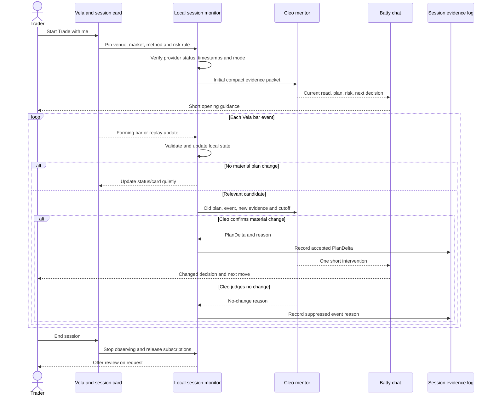

# Trade with me — Cleo mentoring session plan

**Status:** product and engineering proposal, 2026-09-30. No session monitor, proactive Cleo dispatch, account observation, or order execution is claimed to exist yet. The initial build is paper/shadow only.

## Product decision

`Trade with me` starts a deliberate session on the **selected Vela market**. Cleo is the analytical mentor. Batty opens the session, handles conversation and support, and presents Cleo's guidance in a calm, short form. Count Desk owns the local observation loop. A chart update may change the visible state without becoming a message. Cleo speaks when the update materially changes the plan or creates a decision for the trader.

The default is **quiet observation**, with no periodic recap. The trader can ask Cleo anything at any time. A session-end review is available on request or when the trader ends the session.

### What the user sees

1. A **Trade with me** button on Vela opens a small setup card: market, venue, product type (spot or perpetual), decision timeframe, higher-timeframe context, paper method, and the trader's risk rule. It pre-fills only fields supported by the active chart or an explicitly saved paper method. One missing field is requested only if it changes the next decision.
2. The persistent header reads, for example, `CLEO WATCHING · HYPERLIQUID:BTC · 5m · source healthy`, with a visible source timestamp, `Pause`, and `End`. It changes to `RECONNECTING`, `STALE`, or `REPLAY` when applicable.
3. A compact card always shows **Environment**, **Risk**, **Conditional scenarios**, and **Next decision**. It is the trader's memory aid between messages. Its evidence drawer shows source, timeframe, last complete bar, input/settings version, and the reason for a change. A projection is a branch with an activation and invalidation condition, never a certain destination.
4. Messages appear in the chat only when the significance gate below passes. A material warning can speak through optional, user-enabled voice; captions and the plan card are always available. Voice is muted by default and never required to understand a decision.
5. The trader can ask `Why?`, `What would change your mind?`, or `What am I missing?` to expand the current card without losing the place in the session.

## Current repo and data boundary

- Vela registers Hyperliquid, Coinbase Exchange, and Binance browser-side providers in `count-dashboard/web/vela-preview.js`. Hyperliquid is the startup default unless the browser saved another provider. Switching the active chart source disposes the prior connection.
- The provider implementations use live WebSocket market-data streams on supported native intervals, with reconnection and a polling fallback. Hyperliquid supplies candle updates; Coinbase ticker updates build a forming candle; Binance supplies kline updates. Vela's `chart.on('bar', ...)` emits forming-bar changes and also replay bar reveals. It is **not** a normalized stream of every exchange trade print.
- The current `window.countDeskVelaContext` gives Batty the provider, symbol and timeframe. The chat request does not continuously deliver provider bars to Batty or Cleo. A provider card marked connected does not prove that the most recent update is fresh.
- These providers supply public market data. The direct-provider Vela path says no brokerage account is connected and disables its current paper ticket. Any plan that depends on an actual position, fill, fee, or account balance must use a separately authorized source or a clearly labeled user report.
- A session must pin the venue and product identity. The same asset on Hyperliquid, Coinbase, and Binance is three separate observation sources; their prices, fee models, trading rules, and timestamps must not be blended silently.

**Implication:** The first release watches **chart updates from the selected venue**, not every raw trade. A later raw-trades adapter is a separate capability if the product truly needs every print. The mentor's decision points should usually depend on confirmed structure, source freshness, and the paper plan rather than on every print.

Before recording source events or derived chart snapshots beyond the transient session, document each venue's permitted use, retention, and cost scope. A public feed's reachability does not settle those rights. Keep the initial evidence log to permitted, bounded event metadata while that qualification is open.

### One mentor across the trading session

Cleo should keep one coherent voice while drawing on four method lenses: **market environment** (trend, range, transition, volatility and timeframe conflict), **setup** (selected method, entry gate, invalidation and alternate), **risk/management** (structural protection, nearby obstacle, known costs and user-stated position), and **learning** (decision quality, missed/rejected setups, and session reflection). In a paper position, management includes comparing the original plan with the recorded simulated state; a user-reported live fill remains a separate claim. The lenses share one frozen plan and evidence timeline. Additional specialist agents may help on demand, but the trader hears one mentor and never gets competing agent commentary on every chart update.

## Interaction contract: when Cleo speaks

The significance question is: **Would a disciplined mentor change the trader's next decision now, given the evidence available at this timestamp?** An event is worth interrupting for when the answer is yes and the reason can be named.

| Event | Default behavior | Why |
| --- | --- | --- |
| Each forming-bar update; ordinary movement inside the plan | Update the chart and status silently | No decision changed; a forming bar may reverse. |
| Approaching an already selected level for the first time | One quiet heads-up, then silence until a distinct outcome | The trader may want to prepare, but approach is not confirmation. |
| A confirmed close changes the environment or passes a declared setup gate | Cleo sends one short plan update | A planned decision may now be available or canceled. |
| Structural invalidation, risk rule breach, source mismatch, or a move into the nearest opposing obstacle | Immediate visible intervention; optional voice if enabled | The existing plan may no longer fit. |
| Feed disconnect, stale source, symbol switch, or replay activation | Immediate status change; one concise message if a prior plan is being watched | Cleo must stop making freshness-dependent claims. |
| User question or manual paper plan request | Answer directly; expand as asked | The trader invited a conversation. |

### Two-stage significance gate

**Stage 1: deterministic candidate detection, local and fast.** Consume Vela `bar`, `market:changed`, `load:end`, and replay events. Check source/receive timestamps, active venue/symbol/timeframe, bar completion, and whether the update touches a level or condition in the frozen session plan. Produce candidate events only for relevant transitions: `approach`, `first_touch`, `confirmed_break`, `confirmed_rejection`, `regime_change`, `setup_gate_pass`, `invalidation`, `opposing_obstacle`, `risk_violation`, `source_change`, or `feed_health`. Do not call a model on every update or every one-minute close.

**Stage 2: Cleo judges materiality.** For a candidate with valid evidence, compare `old plan → proposed new plan`. Cleo may return `SILENT`, `AMBIENT`, `SPEAK`, or `BLOCKED`. A `SPEAK` result must name the evidence, the affected plan field, the next decision, and the strongest counterpoint. If those fields cannot be filled, keep the previous plan and state what is unknown. One event can be promoted from quiet to spoken when a later close confirms it.

**Interruption policy:** A risk or data-integrity change outranks other messages. Otherwise, coalesce related candidates, suppress repeated messages about the same unchanged condition, and hold a lower-priority heads-up while the trader is entering a paper plan or asking a question. There is no fixed one-minute or hourly message schedule. Allow a user-adjustable `Quiet / Normal` threshold; both preserve feed-health and invalidation notices. Store why an event was emitted or suppressed so the policy can be reviewed.

### Plan versioning

The initial plan is frozen as `plan v1` with source, venue, symbol, product type, timeframes, cutoff, method/rule version, risk rule, and known unknowns. A later change creates a `PlanDelta` with event ID, old state, new state, evidence reference, confirmation time, and Cleo's reason. A candidate that fails confirmation leaves the prior plan intact. If the trader changes the method or risk rule, record that as a user change before evaluating further events. Never relabel a failed paper setup after seeing the outcome.

For spot, a long-only or no-short assumption must come from the selected method, not the symbol. For perps, funding, leverage, liquidation, and venue-specific risk fields are shown only when sourced and relevant. The MYM 30/40-tick rules in Cleo's current futures skill do **not** transfer to crypto. No win probability, net reward/risk, or performance claim is calculated without the necessary recorded method, prices, costs, and outcome study.

## Cleo's communication style

Proactive messages should fit into **one or two short sentences**, with an expandable evidence drawer. Lead with the changed decision, not a market recap. Use the trader's terms, name uncertainty, and allow silence. Ask at most one question when the answer changes the next branch.

| Moment | Example wording |
| --- | --- |
| Session start | “I’m watching the selected BTC market with you. The higher timeframe is still mixed; I’ll stay quiet until your level is tested or the risk picture changes.” |
| First approach | “Price is coming into your marked area. There’s no confirmed reversal yet; I’m watching the close.” |
| Confirmation | “That close changes the plan: the rejection held, and the next test is whether the pullback preserves the new structure. The nearby opposing level still limits the room.” |
| Invalidation | “The close through your invalidation removes the long paper idea. I’d wait here and re-map the next level.” |
| Data failure | “The Coinbase feed stopped updating. I’ve paused chart-based guidance until a fresh source update is verified.” |
| User asks why | “The price touched the area, but the bar never closed back inside it. I was waiting for confirmation, so the plan stayed unchanged.” |

The mentor can disagree: “I would pass. Your setup condition printed, but the opposing level is too close for the structural risk.” Cleo should not create urgency, pretend to know an unreported account position, or issue an order command. The trader operates any manual account; paper plans are separately recorded.

## Session sequence

## Evidence packet and runtime design

The session monitor should subscribe to the **existing Vela `bar` event** and active-market/replay lifecycle events, rather than opening duplicate provider sockets. The event bridge needs a small extension so the monitor can record transport state, `sourceEventTime` where a provider supplies it, `receivedAt`, bar open/close state, and the active replay/live mode. A bar's open timestamp alone does not prove the feed is fresh; a quiet market also should not automatically be marked stale. Use provider heartbeats, connection state, and a bounded source comparison as appropriate.

The first release is an explicitly **foreground** session: closing the chart tab, losing the feed, or ending the session stops observation and proactive messages. The UI must show the stop/reconnect state on return and cannot imply it watched while absent. A later server-side session service would be required for monitoring that survives a closed browser tab, with its own source subscriptions, ownership, retention, and stop controls.

Give Cleo a compact, versioned packet: `sessionId`, `eventId`, active plan hash/version, venue and exact market, spot/perp, timezone, higher and decision timeframes, source and receive timestamps, last complete bar, forming bar flagged provisional, relevant level/structure IDs, nearest opposing obstacle, method gates, risk rule, user-reported position state if any, and the candidate's old/new fields. Keep recent bars and chart drawings available through a bounded read-only fetch. A screenshot is optional visual context and cannot substitute for timestamped market data.

Keep the local session controller separate from the chat request. The current chat launches a fresh synchronous `codex exec` process for each question and waits up to 120 seconds. That path is suitable for a user question but not for a per-update monitor. Maintain the plan and event detector in process; send only material candidate packets to a persistent or pooled Cleo runtime when available. Discard a Cleo reply if the user switched markets or the source/plan version changed while it was being prepared. The immediate source-status and risk-state UI must not wait for a model response.

Measure `event → local status`, `candidate → Cleo start`, `Cleo start → result`, and `result → visible message` separately. A proposed pilot target is a local source/status change visible within 250 ms at the 95th percentile on the supported machine. Measure the model stage before assigning it a deadline; expire a candidate at its next decisive bar or plan change rather than speaking from an obsolete answer. Cache stable method/context and send deltas so each mentor turn stays small.

The support log may record session start/end, source state, candidate type, spoken/suppressed outcome, plan version, and timing. Store no credentials, raw screenshots, prompt bodies, or private account details in that diagnostic stream. Keep detailed paper study records in a separate local evidence store with an explicit retention rule.

## Delivery sequence

1. **Observation pilot:** button, state card, `chart.on('bar')` bridge, venue/symbol pinning, source freshness and replay guards, and a local event log. Show deterministic status with no automatic Cleo messages. Confirm the existing browser feed is genuinely updating on the selected venue.
2. **Shadow mentor:** freeze a paper plan; run candidate detection and Cleo materiality judgments silently. Review spoken-versus-suppressed decisions against time-aligned chart replay and human annotations. Set notification thresholds from the observed false and missed interventions, not from a claimed trading win rate.
3. **Visible mentor:** enable short Cleo interventions, expandable reasons, quiet/normal controls, user question handling, versioned PlanDelta, and `Pause`/`End`. Keep voice optional.
4. **Cleo chart markup:** after the spoken interaction is working, render sourced, versioned marks for a new plan or material `PlanDelta`. Add a Cleo-only visibility toggle and explanation panel; preserve user and Tool Belt drawings. See [CLEO-PLAN-CHART-MARKUP-DESIGN.md](./CLEO-PLAN-CHART-MARKUP-DESIGN.md).
5. **Paper practice and review:** add an authorized paper-only journal path for user-confirmed plans and session reflection. Reconcile positions/fills only with a permitted source; otherwise use user-reported state and label it.
6. **Broader coverage:** define separate spot/perp and venue method cards; add raw trade subscriptions only if a decision rule actually requires every print and the data/use rights and provider behavior are verified.

## Acceptance evidence

- A healthy selected provider shows source and receipt freshness; disconnect, stall, fallback-to-polling, replay, and market switch each produce an honest state. No stale packet is presented as a current read.
- Forming-bar noise and repeated level taps do not cause a message flood. A confirmed invalidation or stale source is surfaced promptly. Every spoken message links to a time-aligned event and a specific changed plan field.
- A human review of recorded shadow sessions can identify missed material events and unwanted interruptions; the thresholds are revised before enabling default spoken guidance. Evaluate **interruption usefulness**, **missed decision points**, **source correctness**, **plan consistency**, and **event-to-message latency** separately from trading outcomes.
- With Cleo unavailable, the card keeps showing validated source state and the last confirmed plan, marked `MENTOR UNAVAILABLE`; it never fabricates a fresh judgment. Pause and End stop observation and future messages.
- No exchange order endpoint, private API key, account change, or live fill is used by this mode. Any paper fill remains distinct from a user-reported live account action.

## Research basis and limits

The interaction design draws from primary human-computer interaction research. [Iqbal and Horvitz's field study of interruption and task resumption](https://www.microsoft.com/en-us/research/wp-content/uploads/2016/11/CHI_2007_Iqbal_Horvitz-1.pdf) found that alerts can lead to extended diversion before people regain their task context. [Horvitz, Jacobs, and Hovel's attention-sensitive alerting work](https://www.microsoft.com/en-us/research/publication/attention-sensitive-alerting/) frames notification value against interruption cost. **Inference for this product:** show low-value chart changes in an ambient card and reserve speech for material decision changes. These studies were not conducted with traders; the shadow pilot must measure whether this policy actually helps Mark.

Provider APIs support the proposed observation sources: [Hyperliquid WebSocket candle and trade subscriptions](https://hyperliquid.gitbook.io/hyperliquid-docs/for-developers/api/websocket/subscriptions), [Coinbase Exchange real-time WebSocket market data](https://help.coinbase.com/en/developer-platform/websocket-feeds/exchange), and [Binance spot kline streams](https://github.com/binance/binance-spot-api-docs/blob/master/web-socket-streams.md). The actual Count Desk adapters currently consume the specific streams described above; official API capability alone does not prove a healthy local subscription or authorize account execution.
